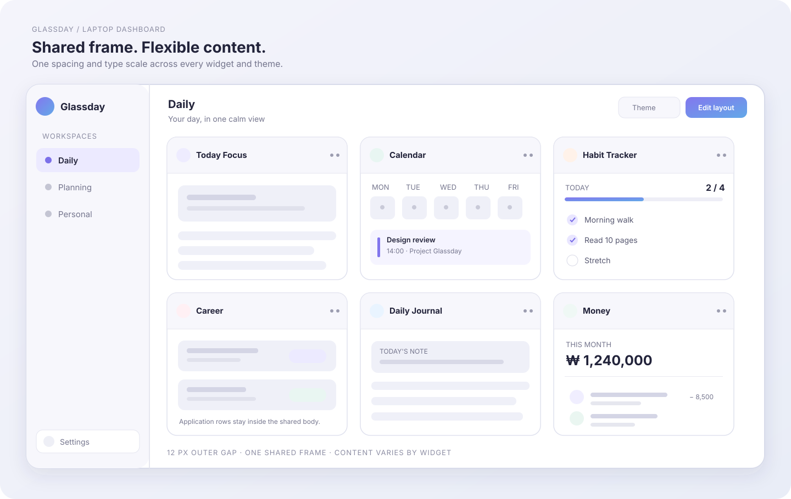
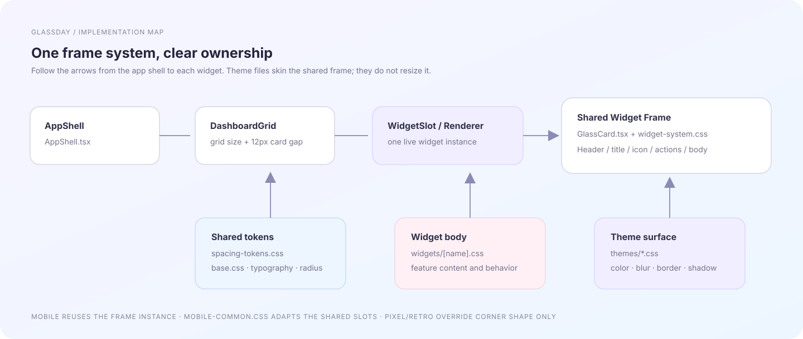
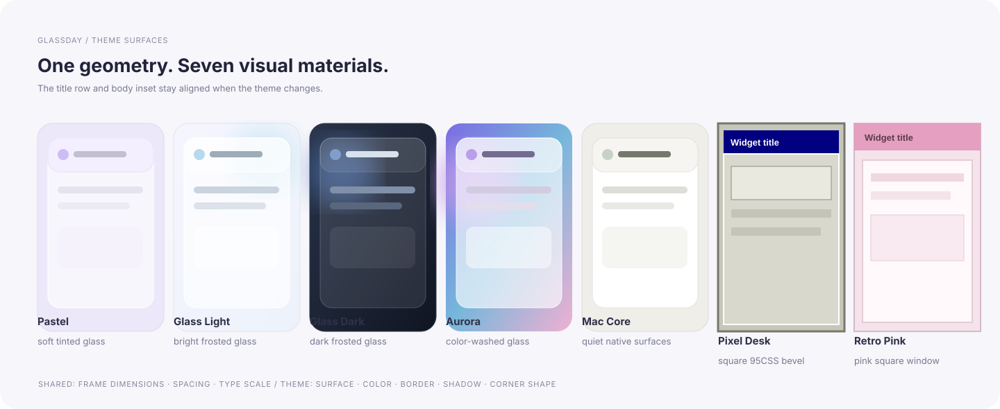

# Glassday · Laptop UI

**`laptop-ui`** is Glassday's desktop dashboard for laptop, Tauri, and the Windows WebView2 shell. It
keeps the same personal widgets and saved data as the mobile experience, with a resizable desktop
canvas, shared widget frames, and theme-specific surfaces.

On the production web URL, portrait phones use the separate mobile layout; rotating to landscape
switches to the horizontal AppShell used by Laptop/Wide. Desktop and Tauri always use AppShell.

> On GitHub, switch the branch selector to **`laptop-ui`** to view this branch's overview and visual
> handoff. The root `README.md` is intentionally written for this branch.

## Laptop dashboard wireframe

The frame below shows the intended hierarchy: app shell, workspace navigation, top bar, and a grid of
widgets. Each widget shares one header and body frame; only the content inside the body varies.



## Figma design system

The Figma handoff keeps common spacing, typography, and widget structure together. Theme modes change
surface color/material, border, shadow, and the intentional square corners in Pixel/Retro themes.

- **Figma design system, token mapping, and component specification:** [Figma Widget Handoff](docs/FIGMA_WIDGET_HANDOFF.md)
- **UI, TSX and CSS map:** [UI Architecture and Figma Guide](docs/UI_ARCHITECTURE_AND_FIGMA_GUIDE.md)

### Shared widget tokens

| Token group | Laptop baseline | Responsibility |
|---|---:|---|
| Card-to-card gap | 12px | Space outside each grid widget |
| Frame inset | 12–16px responsive | Shared header/body padding |
| Title / subtitle | 12–14px / 10–12px responsive | Same frame typography for every widget |
| Widget / inner card / control radius | 20px / 12px / 8px | Shared shape ladder; Pixel Desk and Retro use square corners |
| Theme surface | Per theme | Color, translucency/blur, border, and shadow |

Figma token names map to CSS variables in `src/styles/spacing-tokens.css`, `src/styles/base.css`,
and `src/styles/theme-surfaces.css`. The handoff guide includes the full variable table, frame
construction, component variants, and review checklist.



## Theme preview board

The same widget frame is reused in each theme. Glass themes use a visible backdrop and translucent,
blurred widget surfaces. Pixel Desk keeps Windows 95 square corners; Retro keeps its pink palette and
square frame. Theme styling does not change the shared widget spacing or type scale.



## What is in this branch

- React + TypeScript desktop dashboard, shared by the Tauri shell and WinUI WebView2 shell.
- Draggable and resizable workspace grid with separate saved layouts for Wide and Laptop modes.
- Shared widget frame and typography tokens, with theme-controlled visual surfaces.
- Widgets for today focus, alerts, calendar, career, study, timer, memo, journal, habit tracking,
  money, and mood.
- Mobile-facing improvements that also apply to shared widgets, including the Habit Tracker editing
  flow and shared widget title surfaces.

## Run locally

```bash
npm install
npm run dev
```

Useful project checks:

```bash
npm run lint
npm run build
```

## Where to make changes

| Change | Start here |
|---|---|
| Common widget spacing and typography | `src/styles/spacing-tokens.css` → `src/styles/base.css` → `src/styles/widget-system.css` |
| Desktop grid and the gap between widgets | `src/components/grid/DashboardGrid.tsx` (`--gd-widget-outer-gap`) |
| Shared widget frame markup | `src/components/glass/GlassCard.tsx` |
| One widget's inner content | `src/components/widgets/` and `src/styles/widgets/` |
| Theme colors, surfaces, borders, shadows | `src/styles/theme-surfaces.css`, `src/styles/themes/` |
| Mobile frame and responsive behavior | `src/styles/mobile-common.css`, `src/styles/mobile-*.css` |
| CSS import order | `src/styles/index.css` |

See [docs](docs/) for component maps, token mappings, and design handoff notes.
