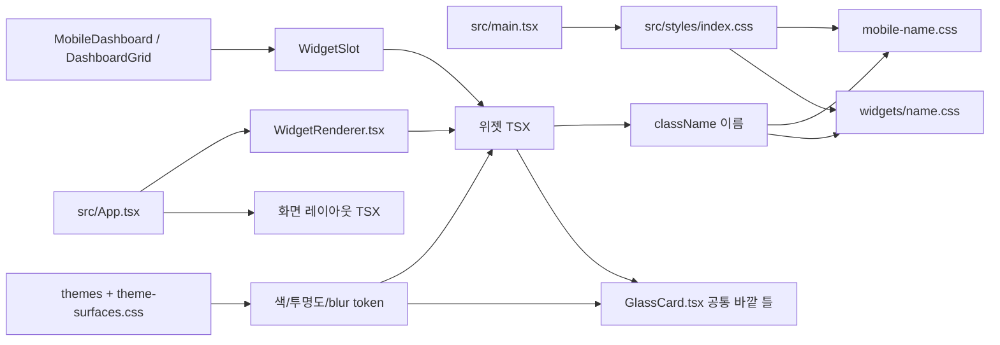

# Glassday TSX와 CSS 연결 지도

이 문서는 코드에서 화면 모양을 찾는 사람을 위한 짧은 길잡이입니다. 모바일 파일 전체 설명과 새 위젯 추가 절차는 [모바일 UI 파일 지도](mobile-ui-map.md), 앱/위젯/Figma 전체 구조는 [UI Architecture and Figma Guide](UI_ARCHITECTURE_AND_FIGMA_GUIDE.md)에 있습니다.

## 먼저 알아둘 연결



- `TSX`는 화면 요소와 동작을 만듭니다. 버튼을 누르면 무엇이 바뀌는지, 어떤 데이터를 표시할지를 담당합니다.
- `className`은 TSX 요소의 이름표입니다. CSS는 이 이름표를 선택해 색, 크기, 간격, 배치를 정합니다.
- `src/styles/index.css`는 CSS 목차이자 실제 로딩 순서입니다. 개별 TSX가 같은 CSS를 중복 import하지 않습니다.
- 테마 파일은 공통 surface token의 색/재질 값을 바꾸고, 공통 layout이나 여백은 소유하지 않습니다.

## 화면별 찾기

| 바꾸고 싶은 것 | 첫 번째로 열 파일 | 이어서 볼 파일 |
|---|---|---|
| 모바일 상단/스크롤/하단 탭 | `src/components/layout/MobileLayout.tsx` | `src/components/layout/MobileNavigation.tsx`, `src/styles/mobile.css` |
| 모바일 위젯 순서/슬롯 | `src/components/mobile/MobileDashboard.tsx` | `WidgetSlot.tsx`, `mobile-common.css` |
| 모든 위젯 제목/아이콘/바깥 여백 | `src/components/glass/GlassCard.tsx` | `src/styles/base.css`, `spacing-tokens.css`, `mobile-common.css` |
| 특정 위젯의 내부 모습 | `src/components/widgets/[Name]Widget.tsx` | `src/styles/widgets/[name].css` |
| 특정 위젯의 모바일 배치 | 위젯 TSX에서 `className` 찾기 | `src/styles/mobile-[name].css`, `src/styles/index.css` |
| 테마 색/투명도/blur | `src/styles/theme-surfaces.css` | `src/styles/mobile-glass.css`, `src/styles/themes/[name].css` |
| Desktop/Laptop 그리드 | `src/components/grid/DashboardGrid.tsx` | `gridDefaults.ts`, `dashboard-grid.css`, `overrides.css` |
| 새 위젯이 선택 목록에 안 나타남 | `src/constants/widgets.ts` | `WidgetRenderer.tsx`, `DashboardGrid.tsx`, `dashboardTabs.ts` |

## 실제 import 순서

화살표 아래 순서대로 `src/styles/index.css`에서 불립니다. 같은 중요도의 규칙이 충돌하면 뒤의 파일이 이길 수 있으므로, 값을 바꾸기 전에는 같은 class를 `rg`로 검색해 중복 정의와 뒤쪽 override를 확인합니다.

```text
1. spacing-tokens.css, fonts.css, base.css
   기본 변수, 폰트, 버튼/GlassCard 공통 구조
2. layout.css, layout-modes.css, controls.css, dashboard-grid.css, overlays.css, command.css
   앱 배치, 그리드, 입력 도구, 팝업
3. themes/*.css, theme-surfaces.css
   테마 선택 색과 semantic surface 변수
4. widgets/*.css
   각 위젯 내부의 기본 구성
5. responsive.css, overrides.css
   화면 크기/호환 보정
6. mobile.css, mobile-calendar/career/memo/money/timer.css
   모바일 화면과 기능별 모바일 콘텐츠
7. mobile-pixel.css, mobile-journal.css, mobile-finish.css
   Pixel Desk, Journal 배치, Mac Core/설정
8. pixel-desktop-parity.css, pink-diary.css, desktop-window.css
   테마 parity와 앱 창 표시
9. responsive-widgets.css, mobile-common.css, mobile-glass.css, pixel-widget-headers.css
   반응형 위젯, 모바일 공통 프레임, Glass 재질, Pixel 제목바
```

## 새 위젯을 추가할 때

1. Figma에서 카드/제목/본문/반복 행/빈 상태와 편집 상태를 정의합니다.
2. `src/types/workspace.ts`의 위젯 ID 규약을 확인하고 `src/constants/widgets.ts`에 표시 이름/설명을 등록합니다.
3. `src/components/widgets/[Name]Widget.tsx`에서 UI와 상호작용을 만들고, 내부 요소에 읽을 수 있는 `className`을 부여합니다.
4. `src/components/widgets/WidgetRenderer.tsx`와 `src/components/grid/DashboardGrid.tsx`에서 실제 React component 연결을 추가합니다.
5. `src/components/grid/gridDefaults.ts`와 `src/constants/dashboardTabs.ts`에 기본 크기/표시 탭을 정합니다.
6. `src/styles/widgets/[name].css`에서 내부 스타일을 만들고, 모바일 조정은 기존 모바일 CSS 책임에 맞춰 넣습니다.
7. `src/styles/index.css`에 파일을 한 번만 연결하고, Figma/코드 파일 지도를 업데이트합니다.

위젯 ID, 저장 데이터, 모바일 예외까지 포함한 자세한 단계는 [모바일 UI 파일 지도](mobile-ui-map.md)의 “새 위젯을 실제 앱에 추가할 때”를 따릅니다. 사용자가 이미 저장한 ID를 바꾸면 기존 배치와 연결이 끊길 수 있으니 ID 변경에는 migration이 필요합니다.
