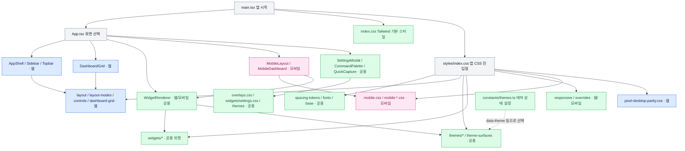

# Glassday TSX-CSS 연결 지도

이 문서는 React 컴포넌트(TSX)가 어떤 스타일 파일의 규칙을 사용하는지, 앱 실행 때 CSS가 어떤 순서로 합쳐지는지 보여준다.

## 전체 연결 다이어그램



**색상 범례:** 파랑은 웹 전용, 분홍은 모바일 전용, 초록은 양쪽에서 공유, 회색은 앱 진입점이다.

### 이 그림 읽는 법

- **화살표는 연결 관계**다. 예를 들어 `CalendarWidget.tsx`가 달력 DOM을 만들고, 그 DOM의 class 이름을 `widgets/calendar.css`가 꾸민다.
- **CSS 파일은 TSX에서 각각 import하지 않는다.** `main.tsx`가 `styles/index.css`를 한 번 불러오고, 그 파일이 앱 CSS를 순서대로 연결한다.
- **테마는 별도 흐름**이다. `constants/themes.ts`가 테마 class/data attribute를 설정하고, `themes/*.css`의 선택자들이 해당 화면에 적용된다.
- **위젯 데이터와 모양은 별개**다. `WidgetRenderer.tsx`가 위젯 컴포넌트를 선택하고, 스타일은 위젯 class 이름에 맞춰 CSS가 적용한다.

## TSX 컴포넌트별 CSS 연결

| TSX 컴포넌트 | 연결되는 CSS와 역할 |
| --- | --- |
| `src/App.tsx` | 데스크톱/모바일 화면을 선택한다. 전역 CSS는 `main.tsx`에서 로드된다. |
| `src/components/layout/AppShell.tsx`, `Sidebar.tsx`, `Topbar.tsx` | `layout.css`, `layout-modes.css`, 테마별 스타일, 반응형 규칙 |
| `src/components/grid/DashboardGrid.tsx` | `dashboard-grid.css`, `layout.css`, `responsive.css`; react-grid-layout 라이브러리 CSS는 이 TSX에서 별도 import |
| `src/components/widgets/WidgetRenderer.tsx` | 실제 위젯 TSX를 골라 렌더링한다. 위젯 외형은 각 위젯 CSS가 담당 |
| `CalendarWidget.tsx`, `calendar/MonthCalendar.tsx`, `calendar/WeekTimeline.tsx` | `widgets/calendar.css`; 모바일 조정은 `mobile-calendar.css` |
| `CareerWidget.tsx` | `widgets/career.css`; 모바일 조정은 `mobile-career.css` |
| `DailyJournalWidget.tsx` | `widgets/journal.css`; 모바일 조정은 `mobile-journal.css`, 공통 마무리 규칙은 `mobile-finish.css` |
| `StudyWidget.tsx` | `widgets/study.css`; 모바일 조정은 `mobile-study.css` |
| `MemoWidget.tsx`, `MoneyWidget.tsx`, `TimerWidget.tsx` | 각 `widgets/memo.css`, `widgets/money.css`, `widgets/timer.css`와 대응되는 `mobile-memo.css`, `mobile-money.css`, `mobile-timer.css` |
| `TodayFocusWidget.tsx`, `AlertCenterWidget.tsx`, `MoodWidget.tsx` | 각 `widgets/today-focus.css`, `widgets/alert-center.css`, `widgets/mood.css` |
| `SettingsModal.tsx` | `widgets/settings.css`, `overlays.css`, 테마별 선택자 |
| `MobileLayout.tsx`, `MobileDashboard.tsx` | `mobile.css`와 `mobile-*.css`; 위젯 내용은 데스크톱과 같은 `WidgetRenderer` 또는 모바일 전용 요약 카드 사용 |
| `MobileCalendarCard.tsx`, `MobileCareerCard.tsx`, `MobileStudyCard.tsx` | 각 `mobile-calendar.css`, `mobile-career.css`, `mobile-study.css`가 담당. 세 CSS 모두 `styles/index.css`에서 전역으로 로드 |

## 실제 로딩 순서

```text
main.tsx
├─ index.css                 Tailwind 기본 레이어
└─ styles/index.css          앱 CSS 진입점, 아래 순서대로 적용
   ├─ spacing-tokens → fonts → base
   ├─ layout / controls / grid / overlays / command
   ├─ themes/* → theme-surfaces
   ├─ widgets/*
   ├─ responsive → overrides
   ├─ mobile.css → mobile 위젯별 CSS → mobile-pixel/journal/finish
   └─ pixel-desktop-parity
```

CSS는 뒤에서 불러온 같은 우선순위 규칙이 앞 규칙을 덮을 수 있다. 그러므로 전역 진입점과 순서를 하나로 유지해야 결과를 예측하기 쉽다.

## 합치거나 정리할 기준

- **이번에 제거한 중복:** `MobileCalendarCard.tsx`, `MobileCareerCard.tsx`, `MobileStudyCard.tsx`의 CSS import. 해당 CSS는 이미 `styles/index.css`에서 불리므로 컴포넌트에서도 불러올 이유가 없었다.
- `src/index.css`와 `src/styles/index.css`는 합치지 않는다. 앞 파일은 Tailwind 진입점이고 뒤 파일은 앱 CSS의 순서표라 역할이 다르다.
- `spacing-tokens.css`와 `base.css`도 분리 유지한다. 변수의 기준값과 실제 공통 프레임 규칙은 서로 다른 책임이다.
- `layout.css`와 `layout-modes.css`는 합칠 수는 있지만, 현재 하나는 공통 화면 배치, 다른 하나는 wide/laptop 모드라 구분이 유효하다. 파일 수만 줄이려고 합치면 찾기 어려워질 수 있어 유지한다.
- **가장 먼저 나눠 정리할 후보는 `overrides.css`(약 118 KB)**다. 파일이 너무 커서 모든 예외를 찾기 어렵다. 규칙을 하나씩 소유 영역(layout/theme/widget/mobile)으로 옮기고, cascade 순서를 확인하며 검증해야 한다.
- `mobile-finish.css`(약 45 KB)는 여러 위젯의 마지막 모바일 보정이 섞여 있다. 한 번에 쪼개지 말고 선택자 중복과 소유 컴포넌트를 확인한 뒤 점진적으로 이동한다.
- 개별 `widgets/*.css`와 테마 CSS는 각자 다른 컴포넌트/테마를 소유하므로 지금은 합치지 않는 편이 낫다.

## 어디를 수정하면 되나

| 바꾸려는 내용 | 우선 확인할 파일 |
| --- | --- |
| 모든 위젯의 공통 간격/크기 | `spacing-tokens.css`, `base.css` |
| 앱 창·사이드바·레이아웃 모드 | `layout.css`, `layout-modes.css`, `dashboard-grid.css` |
| 특정 위젯 내부 | `widgets/<widget>.css` |
| 특정 테마 | `themes/<theme>.css`, `theme-surfaces.css` |
| 모바일에서만 다른 배치 | `mobile*.css` |
| 여러 영역에 걸친 예외 | 마지막 수단으로 `overrides.css`; 가능하면 소유 파일로 옮긴다 |
