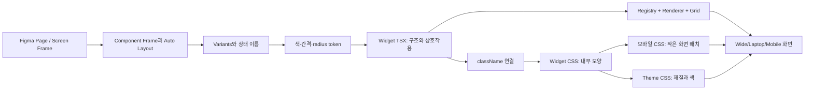

# Glassday UI Architecture and Figma Guide

이 문서는 현재 저장소의 실제 import, component usage, className, Context, storage 연결을
기준으로 작성한 UI 구조 지도다. 화면을 잘 모르는 사람도 화면 이름에서 TSX, CSS, 데이터
파일로 따라갈 수 있고, Figma Component/Variant/Auto Layout을 코드에 대응시킬 수 있도록 한다.

> 모바일 화면의 세부 파일 지도와 처음부터 위젯을 추가하는 단계는
> [모바일 UI 파일 지도](mobile-ui-map.md)를 함께 참고한다. 이 문서는 현재 연결 구조를
> 기록하며 실제 기능/시각 설계는 Figma 시안과 제품 요구사항에서 결정한다.

## 1. 전체 UI 구조

```text
src/main.tsx
└─ App
   ├─ CloudSyncProvider
   │  └─ DashboardDataProvider
   │     ├─ AppShell
   │     │  ├─ Wide Mode: App Shell Surface
   │     │  │  ├─ Sidebar
   │     │  │  │  └─ WorkspaceTabsNav
   │     │  │  ├─ Topbar
   │     │  │  │  ├─ Wide/Laptop Mode Toggle
   │     │  │  │  ├─ Settings Action
   │     │  │  │  └─ Edit Action
   │     │  │  └─ DashboardGrid
   │     │  │     └─ React Grid Layout / Widget instances
   │     │  └─ Laptop Mode: Movable 1080x720 Preview Frame
   │     │     ├─ Laptop Chrome
   │     │     └─ 동일한 Sidebar + Topbar + DashboardGrid shellContent
   │     └─ SettingsModal Portal
   └─ 전역 CSS import: src/styles/index.css
```

`AppShell`은 Wide와 Laptop에서 기능이 다른 두 앱을 만들지 않는다. 같은 `shellContent`를
Wide surface 또는 movable Laptop preview 안에 배치한다. Widget 데이터는 공유하고 Grid
layout만 `DashboardLayoutMode`별로 따로 저장한다.

### Portal / Floating Layer

```text
document.body
├─ FloatingWindow Portal
│  ├─ Calendar Event Window
│  ├─ Memo Window
│  ├─ Money Detail Window
│  ├─ Study Detail Window
│  └─ Timer Window
├─ CareerWidget custom Portal
│  └─ Career Detail Window
└─ SettingsModal custom Portal
   └─ Settings Window
```

공통 `FloatingWindow`는 이동, resize, rect persistence, title bar/body 구조를 제공한다.
Career와 Settings는 현재 각 파일 안의 custom portal/drag 구현을 사용한다. 모든 floating
layer가 같은 구현이라고 가정하면 안 된다.

## 2. Widget이 Dashboard에 나타나는 과정

1. `src/types/workspace.ts`는 Widget ID에 붙이는 타입 이름(`WidgetId`, 현재 `string` 별칭)을 제공한다. 실제 사용하는 ID 목록은 다음 Registry에 있다.
2. `src/constants/widgets.ts`의 `widgetRegistry`가 label, category, default size metadata를 연결한다.
3. `src/components/grid/DashboardGrid.tsx`의 `widgetMap`이 `WidgetId`를 실제 React component로 변환한다.
4. `src/components/grid/gridDefaults.ts`가 Wide/Laptop 및 `lg/md/sm`의 초기 16-column 좌표를 제공한다.
5. `src/constants/dashboardTabs.ts`가 Workspace별 Widget 목록과 초기 layout 사본을 만든다.
6. `src/hooks/useDashboardTabs.ts`가 사용자 tab/layout을 저장하고 신규 default Widget을 병합한다.
7. `DashboardGrid`가 active tab의 `widgetIds`와 현재 mode layout을 `react-grid-layout`에 전달한다.

### 반드시 일치해야 하는 key

```text
WidgetId
= widgetRegistry key
= DashboardGrid.widgetMap key
= GridLayoutItem.i
= DashboardTab.widgetIds item
```

`money`의 이전 호환 이름인 `wealth`는 `DashboardGrid`에서만 alias로 처리된다. 새 layout에는
현재 registry key인 `money`를 사용한다.

### Grid 기준

- 내부 breakpoint: `lg = 980`, `md = 620`, `sm = 0`
- 모든 breakpoint column: `16`
- Laptop: `rowHeight = 46`, `margin = 10`
- Wide: `rowHeight = 52`, `margin = 14`
- 실제 값: `src/components/grid/DashboardGrid.tsx`
- 초기 좌표: `src/components/grid/gridDefaults.ts`
- 저장된 사용자 좌표: `glassday.dashboard.tabs.v1`

## 3. 파일 연결표

| UI 영역 | React 파일 | CSS 파일 | Data / Context | Type | Theme 연결 | Grid 등록 | Figma 이름 |
|---|---|---|---|---|---|---|---|
| Root | `src/App.tsx` | `base.css`, `responsive.css` | CloudSyncContext, DashboardDataContext | `workspace.ts` | `constants/themes.ts` | - | App Root |
| App Shell | `components/layout/AppShell.tsx` | `layout-modes.css`, `base.css` | local UI state | `DashboardLayoutMode` | 모든 Theme CSS | - | App Shell / Wide · Laptop |
| Sidebar | `components/layout/Sidebar.tsx` | `base.css`, `responsive.css`, Theme CSS | useDashboardTabs | DashboardTab | Theme별 sidebar override | - | Sidebar / Expanded · Collapsed |
| Topbar | `components/layout/Topbar.tsx` | `controls.css`, `responsive.css`, Theme CSS | layout/edit/settings callback | `DashboardLayoutMode` | Theme별 topbar override | - | Topbar / Desktop · Mobile |
| Workspace Tabs | `components/layout/WorkspaceTabsNav.tsx` | `responsive.css`, Theme CSS | useDashboardTabs | DashboardTab | icon/theme event | - | Workspace Tab Item |
| Dashboard Grid | `components/grid/DashboardGrid.tsx` | `dashboard-grid.css`, `overrides.css` | useDashboardTabs | GridLayoutItem, WidgetId | 공통 surface token | Renderer | Dashboard Canvas / Edit Variant |
| Floating Window | `components/common/FloatingWindow.tsx` | `overlays.css` | rect localStorage | FloatingWindowProps | Theme/Widget overrides | - | Floating Window |
| Glass Card | `components/glass/GlassCard.tsx` | `base.css`, `spacing-tokens.css` | props | GlassCardProps | theme-surfaces.css | 모든 Widget | Widget Frame |
| Settings | `components/settings/SettingsModal.tsx` | `layout.css`, `widgets/settings.css` | CloudSyncContext, backup/fonts/themes | ThemeId | 모든 Theme preview/override | - | Settings Window |
| Today Focus | `components/widgets/TodayFocusWidget.tsx` | `widgets/today-focus.css` | DashboardDataContext, local tasks, Memo preview | local types | Theme surface | `today` | Widget / Today Focus |
| Alert Center | `components/widgets/AlertCenterWidget.tsx` | `widgets/alert-center.css` | localStorage readers, studyUtils | local AlertItem | tone + Theme | `alerts` | Widget / Alert Center |
| Calendar | `components/widgets/CalendarWidget.tsx` | `widgets/calendar.css` | DashboardDataContext | `dashboard.ts` | event color + Theme | `calendar` | Widget / Calendar |
| Career | `components/widgets/CareerWidget.tsx` | `widgets/career.css` | DashboardDataContext | `dashboard.ts` | Theme surface | `career` | Widget / Career |
| Study | `components/widgets/StudyWidget.tsx` | `widgets/study.css` | useLocalStorage, studyUtils | `study.ts` | subject color + Theme | `study` | Widget / Study Planner |
| Timer | `components/widgets/TimerWidget.tsx` | `widgets/timer.css` | usePomodoroTimer | `study.ts` | semantic accent | `timer` | Widget / Timer |
| Memo | `components/widgets/MemoWidget.tsx` | `widgets/memo.css` | useLocalStorage, fonts/themes | local MemoNote | paper palette + Theme | `memo` | Widget / Memo |
| Daily Journal | `components/widgets/DailyJournalWidget.tsx` | `widgets/journal.css` | journalUtils | `journal.ts` | inner surface token | `journal` | Widget / Daily Journal |
| Habit Tracker | `components/widgets/HabitTrackerWidget.tsx` | `widgets/habit-tracker.css` | useLocalStorage | local Habit[] | shared surface tokens | `habitTracker` | Widget / Habit Tracker |
| Money | `components/widgets/MoneyWidget.tsx` | `widgets/money.css` | useLocalStorage, moneyUtils | `money.ts` | category color + Theme | `money` | Widget / Money |
| Mood | `components/widgets/MoodWidget.tsx` | `widgets/mood.css` | useLocalStorage | local MoodValues | metric accent + Theme | `mood` | Widget / Mood |

## 4. Widget별 Figma 구조

### Today Focus

- Root: `Widget / Today Focus`, Vertical Auto Layout
- Child Frames: Header, Hero Summary, Top Tasks, Calendar/Career Grid, Pinned Memo, Alert
- Components: Editable Task Row, Linked Summary Row, Deadline Badge
- Variants: Default, Empty, Urgent, Compact
- Scroll: GlassCard body
- Fixed: Header action
- Tokens: 공통 Widget Frame token, Theme surface token

### Alert Center

- Root: `Widget / Alert Center`, Vertical Auto Layout
- Child Frames: Header, Alert List
- Components: Alert Row, Severity Icon, Meta Badge
- Variants: danger, warning, info, success, empty
- Scroll: `.alert-center-list`
- Fixed: Header/Refresh

### Calendar

- Root: `Widget / Calendar`, Vertical Auto Layout
- Child Frames: Header, Date Toolbar, View Toggle, Current Label, View Body, Sync Footer
- Components: Day Event Row, Week Event Block, Month Day Cell, Color Swatch
- Variants: Day, Week, Month, Empty, Career Managed
- Responsive: Month cell와 Week column은 Calendar container 기준
- Scroll: view별 Calendar body, Floating event form
- Fixed: Widget Header, Floating Title Bar

### Career

- Root: `Widget / Career`, Vertical Auto Layout
- Child Frames: Header, Summary Grid, View/Status Filters, List 또는 Board
- Components: Application Card, Status Chip, D-Day Badge, Board Column
- Variants: List, Board, Empty, Detail Open, detailOnly
- Floating: Career 전용 portal; Title Bar fixed, detail body scroll

### Study Planner

- Root: `Widget / Study Planner`, Vertical Auto Layout
- Child Frames: Summary, Date Bar, Subject/Timer Controls, Workspace
- Workspace: Timeline Grid + Task/Memo Side Panel
- Components: Subject Chip, 10-minute Cell, Task Row, Goal Progress, Timer Control
- Variants: Widget, Detail, Timer Active, Subject Selected, Eraser, Empty
- Scroll: Timeline/side panel이 container 크기에 따라 독립 scroll
- Fixed: Header, Summary, Date Navigation

### Timer

- Root: `Widget / Timer`
- Child Frames: Mode Toggle, Progress Clock, Actions, Completion Prompt, Settings
- Components: Circular Progress, Primary/Secondary Action, Duration Stepper
- Variants: Focus, Short Break, Long Break, Running, Paused, Complete, Floating
- Floating: Grid와 같은 Hook instance 공유

### Memo

- Root: `Widget / Memo`, Vertical Auto Layout
- Child Frames: Header Actions, optional List Panel, Workspace
- Workspace: Title, Formatting Toolbar, Editor
- Components: Memo List Row, Toolbar Button, Paper Swatch, Table Context Menu
- Variants: Read Only, Editing, List Hidden, Popover, Inline, Floating
- Scroll: Memo content는 `.memo-editor`, note list는 `.memo-note-list`
- Fixed: Header/Toolbar; Floating Title Bar
- Responsive: ResizeObserver + Memo container size

### Daily Journal

- Root: `Widget / Daily Journal`, Vertical Auto Layout
- Child Frames: Header/Date Nav, Summary + Condition, Main Scroll Body
- Components: Summary Metric, Condition Stepper, Task Row, Clip Row, Journal Section
- Variants: Empty, Partial, Complete, Compact
- Scroll: `.journal-main-scroll`
- Fixed: Header/Summary

### Money

- Root: `Widget / Money`
- Compact Children: Monthly Summary, Budget, Donut, Recent Transactions
- Detail Variants: Overview, Spending, Wishlist, Recurring
- Components: Transaction Row, Wishlist Card, Recurring Row, Form Field, Donut Legend, Store Bar
- Overlay Variants: Wishlist Detail, Purchased Dialog, Add Form Open/Closed
- Scroll: 모바일 대시보드에서는 본문이 카드 높이에 맞게 늘고 페이지가 스크롤한다. 거래 목록과 편집 다이얼로그에는 필요한 내부 스크롤이 있다.
- Data color: category palette는 theme token과 독립적인 finance data palette

### Mood

- Root: `Widget / Mood`
- Components: Metric Row, Score Dot
- Variants: Read Only, Editing, Score 1~5
- Scroll: Widget body
- Responsive: `mood-widget` container query

### Habit Tracker

- Root: `Widget / Habit Tracker`
- Child Frames: Today Progress, Week Labels, Habit Row, Edit Form, Color Swatches, History
- Variants: Empty, Read Only, Editing, Completed Today, Habit Color
- Storage: 습관 이름, 사용자 색, 요일별 완료 기록을 위젯 데이터로 저장한다.
- 주의: 예전 `health` widget ID는 현재 `useDashboardTabs.ts`에서 `habitTracker`로 이관한다. 새 화면이나 Figma Component의 key는 `habitTracker`를 쓴다.

## 4.1 Figma 시안에서 새 컴포넌트로 이어지는 경로



**Figma에서 코드로 옮길 때 지킬 약속**

1. Figma의 카드 바깥/제목줄을 기존 `Widget Frame`과 맞춘다. TSX에서는 `GlassCard`를 재사용하고 내부 본문만 새로 구성한다.
2. Figma Layer/Component 이름은 읽기 쉬운 화면 언어로 짓는다. 그 이름을 TSX `className`과 CSS 선택자에 그대로 연결한다. 예: `Habit Row` → `habit-tracker__item`.
3. 공통 간격은 `spacing-tokens.css` 토큰을 우선 쓴다. 위젯 전용 반복 간격이 필요하면 CSS custom property 한 곳에서 정의하고 child들이 그 값을 쓴다.
4. 색상 모드는 Figma Variable Mode와 `theme-surfaces.css`의 semantic token을 대응시킨다. 직접 고른 사용자 데이터 색은 theme surface token과 구별한다.
5. Variant마다 보이는 요소와 동작을 먼저 표로 정한다. Disabled/Empty/Editing 같은 상태를 CSS만으로 흉내 내지 말고 TSX 상태와 연결한다.
6. Figma에서 확정한 바깥 여백, 카드 제목 위치, body 시작선은 공통 frame 책임이다. 특정 widget CSS에 복제하지 않는다.
7. 화면이 추가되면 `docs/mobile-ui-map.md`의 연결표와 이 문서의 Figma 구조표도 함께 고친다.

| 코드에서 바꾸려는 것 | 시작 파일 | 연결해서 확인할 파일 |
|---|---|---|
| 새 위젯의 실제 ID와 선택기 이름/설명/분류 | `src/constants/widgets.ts` | `WidgetId` 타입은 `src/types/workspace.ts`에서 확인 |
| 실제 위젯을 화면으로 만들기 | `src/components/widgets/[Name]Widget.tsx` | `GlassCard.tsx`, feature CSS |
| ID를 React 위젯에 연결 | `src/components/widgets/WidgetRenderer.tsx` | `widgetComponents` |
| 큰 화면 그리드 목록/기본 위치 | `src/components/grid/DashboardGrid.tsx`, `gridDefaults.ts` | `dashboardTabs.ts`, `useDashboardTabs.ts` |
| 내부 구조와 큰 화면 스타일 | `src/styles/widgets/[name].css` | TSX `className` |
| 모바일 배치와 콘텐츠 크기 | `src/styles/mobile-[name].css` 또는 위젯 CSS의 모바일 구간 | `src/styles/index.css`, `mobile-common.css` |
| 테마별 색/재질 | `theme-surfaces.css`, `themes/[theme].css` | Figma Variable Mode |

추가 절차와 모바일 배치 예시는 [모바일 UI 파일 지도](mobile-ui-map.md)의 “새 위젯을 실제 앱에 추가할 때”를 따른다.

## 5. Theme Map

### 활성 Theme

| ThemeId | CSS 파일 | 적용 selector | Figma Variable Mode |
|---|---|---|---|
| `pastel` | `styles/themes/pastel.css` | `.theme-pastel` | Pastel |
| `glass-light` | `styles/themes/glass-light.css` | `[data-theme="glass-light"]`, `.theme-glass-light` | Glass Light |
| `glass-dark` | `styles/themes/glass-dark.css` | `[data-theme="glass-dark"]`, `.theme-glass-dark` | Glass Dark |
| `aurora` | `styles/themes/aurora.css` | `[data-theme="aurora"]`, `.theme-aurora` | Aurora |
| `mac-core` | `styles/themes/mac-core.css` | `[data-theme="mac-core"]`, `.theme-mac-core` | Mac Core |
| `pixel-desk` | `styles/themes/pixel.css` | `[data-theme="pixel-desk"]`, `.theme-pixel-desk` | Pixel Desk |
| `retro` | `styles/themes/retro.css` | `[data-theme="retro"]`, `.theme-retro` | Retro 98 |

저장된 과거 `glass` 테마 값은 `constants/themes.ts`에서 `glass-light`로 migration된다.

### Theme 적용 경로

```text
SettingsModal Theme Card
→ applyTheme(themeId)
→ html/body: theme-{id} class + data-theme={id}
→ base token override + Theme-specific selector
→ GlassPanel / GlassCard / Controls / Widget inner surface / Floating Window
```

Aurora는 `applyTheme()`에서 `.theme-glass-dark` compatibility class도 받아 기존 dark Widget
selector를 재사용한 뒤 `aurora.css`에서 surface를 재정의한다.

### 주요 Token 그룹

- Base color: `--background`, `--foreground`, `--card`, `--card-foreground`
- Semantic: `--primary`, `--primary-foreground`, `--muted`, `--muted-foreground`
- Control: `--border`, `--input`, `--ring`
- Radius: `--gd-radius-app`, `--gd-radius-panel`, `--gd-radius-widget`, `--gd-radius-card`
- App surface: `--gd-app-bg`, `--gd-app-border`, `--gd-app-shadow`, `--gd-app-filter`
- Widget surface: `--gd-surface-bg`, `--gd-surface-border`, `--gd-surface-shadow`, `--gd-surface-filter`
- Inner/control surface: `--gd-inner-bg`, `--gd-inner-border`, `--gd-control-*`
- Spacing: `--gd-space-*`, Widget Frame aliases in `spacing-tokens.css`

Theme 색을 바꿀 때 layout CSS의 `padding`, `gap`, Grid 좌표를 함께 수정하지 않는다.

## 6. Data Flow

### 공통 local persistence

```text
User Interaction
→ Widget handler
→ useLocalStorage setter
→ window.localStorage.setItem
→ patched GLASSDAY_STORAGE_EVENT
→ 같은 탭의 Hook state update
→ Widget re-render
```

다른 브라우저 탭은 native `storage` event를 사용한다. Supabase snapshot 적용은 bulk custom
event를 발생시켜 열린 Widget을 다시 읽게 한다.

### Calendar / Career shared flow

```text
Calendar 또는 Career interaction
→ useDashboardData action
→ DashboardDataContext
→ useLocalStorage
→ calendar/career key 저장
→ Career date ↔ Calendar projection sync
→ 두 Widget re-render
```

Context key:

- `glassday.calendar.events.v1`
- `glassday.career.applications.v2`

`activeCareerDetailId`만 임시 React state이며 새로고침 persistence 대상이 아니다.

### 주요 Widget storage

| Widget / 기능 | Source of Truth | localStorage key |
|---|---|---|
| Dashboard tabs/layout | useDashboardTabs | `glassday.dashboard.tabs.v1` |
| Active Workspace | useDashboardTabs | `glassday.dashboard.activeTab.v1` |
| Layout mode | App | `glassday.dashboard.layoutMode.v1` |
| Study | StudyWidget | `glassday.study.planner.v2` |
| Pomodoro | usePomodoroTimer | `glassday.study.pomodoro.v1` |
| Journal | journalUtils | `glassday.journal.entries.v1` |
| Memo | MemoWidget | `glassday.memo.notes.v2` 및 selection/list/width key |
| Money | MoneyWidget | `glassday.money` |
| Mood | MoodWidget | `glassday.mood` |
| Habit Tracker | HabitTrackerWidget | `glassday.habits.tracker.v1` |
| Today Focus tasks | TodayFocusWidget | `glassday.todayFocus.tasks.v1` |
| Theme | themes.ts | `glassday.theme` |
| Interface font | fonts.ts | `glassday.ui.font.v1` |

### Supabase flow

```text
Local durable data change
→ glassdayStorage allowed-prefix snapshot
→ CloudSyncContext debounce/upload
→ Supabase user_storage_snapshots (user_id당 한 row)
→ 다른 기기 로그인/hydrate
→ compatible snapshot apply
→ GLASSDAY_STORAGE_EVENT bulk
→ Widget re-render
```

Wide/Laptop mode, active tab, Grid layout, theme은 cloud restore 대상에서 제외된 local UI shell이다.
이 경계는 로그인 후 오래된 화면 layout으로 돌아가는 문제를 막는다.

## 7. CSS 연결과 읽는 순서

`src/styles/index.css`의 import 순서는 다음과 같다.

1. `spacing-tokens.css`, `fonts.css`, `base.css`
2. `layout.css`, `layout-modes.css`, `controls.css`, `dashboard-grid.css`, `overlays.css`
3. 활성 Theme CSS + `theme-surfaces.css`
4. Widget CSS
5. `responsive.css`, `overrides.css`

### CSS 책임 경계

- `spacing-tokens.css`: Figma Variables와 대응하는 공통 spacing/geometry
- `base.css`: Widget Frame/Glass primitive
- `layout-modes.css`: Wide/Laptop shell density
- `dashboard-grid.css`: drag/resize/edit state
- `overlays.css`: 공통 Floating Window layer/shell
- `themes/*.css`: color, material, shadow, blur, theme-specific shape
- `widgets/*.css`: 각 Widget 내부 Frame와 container query
- `responsive.css`: viewport 기준 App shell/mobile 구조
- `overrides.css`: 마지막 safety guard; 신규 디자인을 두는 파일이 아님

## 8. 영향 범위 가이드

### Widget 색상을 바꿀 때

1. 해당 `widgets/*.css`가 semantic token을 쓰는지 확인한다.
2. Theme 공통 변경이면 `theme-surfaces.css` token을 수정한다.
3. 특정 Theme만 바꾸면 해당 `themes/*.css` selector만 수정한다.
4. Calendar/Money/Study의 data palette인지 Theme surface인지 먼저 구분한다.

### Theme를 추가할 때

1. `constants/themes.ts`의 `ThemeId`와 `themeOptions`
2. 새 Theme CSS와 `styles/index.css` import
3. Settings Theme preview selector
4. Sidebar/Topbar/Widget/Floating/Scrollbar override 확인
5. `applyTheme()`의 class/data-theme 적용 및 compatibility 요구 확인

### Widget 기본 크기를 바꿀 때

1. `components/grid/gridDefaults.ts`
2. `constants/dashboardTabs.ts`가 해당 default를 선택하는지 확인
3. `DashboardGrid.tsx`의 min/max size contract 확인
4. 기존 사용자 저장 layout은 자동 교체되지 않는다는 점 확인

### 새 Widget을 등록할 때

1. `types/workspace.ts`의 `WidgetId` 규약을 확인한다. 현재는 `string` 별칭이므로 별도 ID 목록에 값을 추가하지 않지만, 타입을 제한된 목록으로 바꾸는 설계라면 새 값도 등록한다.
2. `constants/widgets.ts` metadata
3. `DashboardGrid.tsx` widgetMap
4. `gridDefaults.ts`의 Wide/Laptop 및 lg/md/sm 좌표
5. `dashboardTabs.ts`의 대상 Workspace widgetIds
6. Widget TSX/CSS와 storage cloud scope

### Floating Window 스타일을 바꿀 때

1. 공통 shell이면 `common/FloatingWindow.tsx` + `overlays.css`
2. Widget body면 해당 Widget CSS
3. Career/Settings는 custom portal 구현인지 별도 확인
4. Theme별 background/blur/border override 확인
5. z-index와 pointer-events가 Dashboard drag를 막지 않는지 확인

### Widget 데이터를 추가할 때

1. 활성 Type 파일과 normalize/migration helper
2. Context 또는 Widget의 실제 Source of Truth
3. 기존 localStorage key 호환
4. `glassdayStorage.ts`의 cloud allowed prefix 포함 여부
5. backup/import/reset 범위
6. Figma text/badge/form field와 Empty State

### 모바일/App shell을 변경할 때

1. `responsive.css`의 viewport breakpoint
2. `layout-modes.css`의 Laptop frame token과 혼동하지 않는다.
3. Sidebar/Topbar/WorkspaceTabsNav DOM 구조
4. Widget 내부 변화는 해당 container query에서 처리한다.

## 9. Figma 파일 구성 제안

무료 페이지 수를 아끼면서 현재 구조를 이해하기 쉬운 구성은 다음과 같다.

### File 1: Foundations and Shell

- Page 1: Color/Effect/Typography/Spacing Variables
- Page 2: AppShell, Sidebar, Topbar, Wide/Laptop Variants
- Page 3: Widget Frame, Controls, Floating Window Components

### File 2: Productivity Widgets

- Page 1: Today Focus, Alert Center, Calendar
- Page 2: Career, Study, Timer
- Page 3: Memo, Daily Journal

### File 3: Life, Finance, Theme QA

- Page 1: Habit Tracker, Money, Mood
- Page 2: Settings, Auth/Sync, Backup/Reset
- Page 3: Theme Variant comparison and responsive test frames

Figma layer 이름은 코드 class 전체를 복사하기보다 이 문서의 `Figma 이름`과 TSX의
`Figma Frame` 주석을 우선 사용한다. CSS class는 implementation link로 description에 적는다.

## 11. 변경 전 체크리스트

- 지금 수정하는 값이 Theme, Layout, Grid, Widget 내부, Data 중 어느 layer인지 구분했는가?
- WidgetId와 Grid item `i`를 함께 확인했는가?
- viewport media query와 Widget container query를 혼동하지 않았는가?
- `min-width: 0` / `min-height: 0`이 내부 scroll을 위한 제약인지 확인했는가?
- Floating Window가 공통 구현인지 Career/Settings custom portal인지 확인했는가?
- 저장 key/type을 바꿀 때 migration과 Supabase snapshot을 확인했는가?
- legacy/inactive 파일이 아니라 실제 render tree를 수정하고 있는가?

