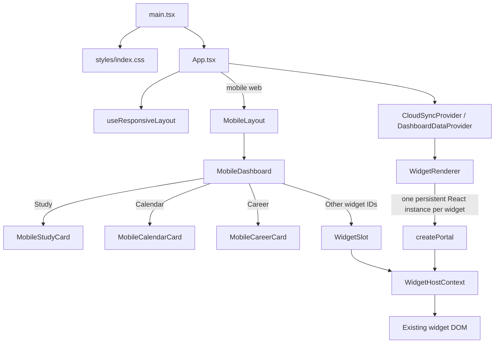
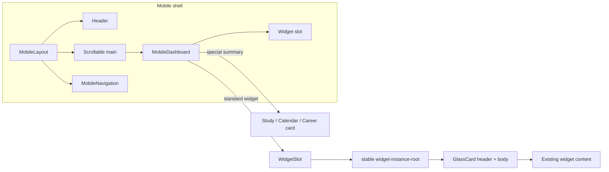
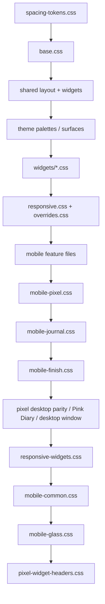

# Glassday 모바일 UI 파일 지도

이 문서는 모바일 웹 화면의 렌더링 흐름, 컴포넌트와 스타일의 연결, CSS 파일별 소유 범위를 설명한다. 모바일 화면을 고칠 때 어느 파일을 수정해야 하는지 찾는 기준 문서다.

## 1. 화면이 만들어지는 흐름



`WidgetRenderer`는 위젯을 한 번 생성해 안정된 DOM host에 보관한다. 데스크톱과 모바일이 바뀌어도 `WidgetSlot`이 host를 새 슬롯으로 옮기므로 Memo 입력 상태나 Timer 상태가 두 벌로 생기지 않는다. Study, Calendar, Career는 모바일 전용 카드가 요약 화면을 제공하지만, 상세 화면이나 기존 편집 기능은 원래 위젯 인스턴스에 연결한다.



모바일 모드 판정은 `useResponsiveLayout.ts`가 맡는다. 768px 미만 viewport 또는 모바일 브라우저 user agent면 모바일 셸을 사용하며, Tauri에서는 항상 데스크톱 셸을 유지한다.

## 2. TSX 파일 책임

| 파일 | 담당 역할 | 이어지는 파일 |
|---|---|---|
| `src/App.tsx` | 화면 모드 선택, Provider 배치, 공용 `WidgetRenderer`, Mobile/Desktop shell 렌더링 | `useResponsiveLayout`, `WidgetRenderer`, `MobileLayout`, `DashboardGrid` |
| `src/hooks/useResponsiveLayout.ts` | 브라우저/viewport의 모바일 웹 판정. 저장된 위젯 배치나 데이터는 변경하지 않음 | `App.tsx`, `TimerWidget.tsx` |
| `src/components/layout/MobileLayout.tsx` | 모바일 전체 viewport, 상단 헤더, 스크롤 영역, 하단 탐색의 골격 | `MobileNavigation`, `MobileDashboard`, `mobile.css` |
| `src/components/layout/MobileNavigation.tsx` | 워크스페이스 탭과 Quick Capture 버튼 렌더링, 테마 변경 반영 | `WorkspaceTabIcon`, `mobile.css`, `mobile-common.css` |
| `src/components/mobile/MobileDashboard.tsx` | 활성 탭 `widgetIds` 순서대로 모바일 카드/위젯 슬롯을 배치 | 세 모바일 요약 카드, `WidgetSlot`, `mobile-common.css` |
| `src/components/mobile/MobileStudyCard.tsx` | 학습 요약과 상세 화면 탭. 상세에서는 기존 Study 위젯을 `WidgetSlot`으로 재사용 | `StudyWidget`, `studyUtils`, `mobile-study.css` |
| `src/components/mobile/MobileCalendarCard.tsx` | 날짜/일정 요약, 전체 화면 달력, 기존 Calendar 편집기 호출 | `DashboardDataContext`, `CalendarWidget`, `mobile-calendar.css` |
| `src/components/mobile/MobileCareerCard.tsx` | 지원 현황/회사 목록 요약. 기존 Career 상세 편집기를 열고 원본 데이터를 사용 | `DashboardDataContext`, `CareerWidget`, `mobile-career.css` |
| `src/components/widgets/WidgetRenderer.tsx` | 지원하는 모든 위젯의 React 인스턴스를 만들고 portal host에 계속 유지 | 모든 `*Widget.tsx`, `widgetHostContext.ts` |
| `src/components/widgets/WidgetSlot.tsx` | 현재 레이아웃 위치에 기존 portal host를 붙임. 위젯 상태나 저장을 소유하지 않음 | `widgetHostContext.ts` |
| `src/components/widgets/widgetHostContext.ts` | 위젯별 안정된 DOM host 생성/이동, breakpoint 전환 때 focus/selection 보존 | `WidgetRenderer`, `WidgetSlot` |
| `src/components/glass/GlassCard.tsx` | 공통 위젯 제목줄과 본문 DOM 구조 제공 | `base.css`, `mobile-common.css`, 테마 CSS |
| `src/components/widgets/TimerWidget.tsx` | Pomodoro controller와 대시보드/플로팅 Timer UI 공유 | `timer.css`, `mobile-timer.css`, `usePomodoroTimer` |
| `src/components/widgets/DailyJournalWidget.tsx` | 날짜별 Journal 콘텐츠와 모바일 요약 접기 상태 | `journal.css`, `mobile-journal.css`, `mobile-common.css` |
| `src/components/widgets/MemoWidget.tsx` | 메모 목록/편집기와 별도 전체 화면 편집기 | `memo.css`, `mobile-memo.css` |
| `src/components/widgets/MoneyWidget.tsx` | 기존 Money 요약/거래/탭 화면 | `money.css`, `mobile-money.css` |
| `src/components/mobile/MobileWidgetEditor.tsx`, `src/hooks/useMobileWidgetLayout.tsx` | 사용처가 없던 모바일 전용 위젯 편집기와 저장 hook. 현재 앱 트리에서 호출되지 않아 제거됨 | 이전 저장 키 `glassday.mobile.widgets.v1`도 더 이상 로그인 화면 스냅샷에 포함하지 않음 |

### 기존 위젯을 두 번 만들지 않는 규칙

- `WidgetRenderer`가 기존 위젯 인스턴스를 소유한다.
- 모바일 요약 카드 안에 같은 위젯 컴포넌트를 다시 렌더링하지 않는다.
- 모바일 카드에서 상세/편집 기능이 필요하면 Context 이벤트나 `WidgetSlot`으로 기존 인스턴스에 연결한다.
- Health의 과거 모바일 배치 ID를 Habit Tracker로 옮기는 `useDashboardTabs` migration은 실제 저장된 탭을 보존하므로 유지한다. 제거된 위젯 편집기의 local storage 코드는 앱에서 참조되지 않아 제거했다.

## 3. 스타일 적용 흐름

모바일 CSS는 컴포넌트에서 개별 import하지 않는다. `src/main.tsx`가 `src/styles/index.css`를 한 번 불러오고, `index.css`가 모바일 파일까지 중앙에서 import한다.



뒤에서 import되는 CSS가 앞 규칙을 덮을 수 있다. `mobile-common.css`는 모바일 프레임 geometry의 최종 소유자다. `mobile-glass.css`와 `mobile-pixel.css`는 모양/재질만 테마에 맞춘다. 개별 기능 CSS에서 프레임 여백이나 제목 치수를 재정의하지 않는다.

## 4. 모바일 CSS 파일별 책임

| CSS 파일 | 여기서 다루는 것 | 여기에 넣지 않을 것 |
|---|---|---|
| `src/styles/index.css` | 전체 CSS import 순서 | 화면별 실제 규칙 |
| `src/styles/spacing-tokens.css` | 공통 spacing/radius/위젯 높이 토큰. 모바일은 4px 단계와 `--gd-mobile-widget-*` 값을 제공 | 개별 widget의 선택자/임의 수치 |
| `src/styles/base.css` | `.widget-frame`의 공통 header/body 구조와 기본 surface | 모바일 전용 규칙 |
| `src/styles/mobile.css` | `.mobile-layout`, header, main scroller, bottom nav, Quick Capture, 설정 창의 모바일 배치, Today/Alert/Career 콘텐츠 밀도 | 위젯 공통 frame inset과 title geometry |
| `src/styles/mobile-common.css` | 대시보드 외부 gutter/gap, slot/host 크기, 모든 공통 위젯 본문 inset, 제목 시작선/높이/아이콘/글자/액션, 전용 Study/Calendar/Career 카드의 공통 간격, narrow Journal header, Settings 공통 배치 | 테마별 색/재질, 각 위젯 내부의 도메인 행 배치 |
| `src/styles/mobile-study.css` | Study 요약 카드 내부, 시간표/할 일/메모 상세 포털의 그리드와 입력 크기 | Study 외부 카드 inset/titlebar |
| `src/styles/mobile-calendar.css` | Calendar 요약 내부, month/week/agenda, 상세 달력, 기존 Calendar 편집기 포털 | Calendar 외부 카드 inset/titlebar |
| `src/styles/mobile-career.css` | Career 요약/목록/검색/상세 편집기와 포털 | Career 외부 카드 inset/titlebar |
| `src/styles/mobile-memo.css` | Memo 미리보기, 메모 목록, 편집기 내부 도구와 full-screen 편집기 | 공통 GlassCard 본문 inset |
| `src/styles/mobile-money.css` | Money 탭, 요약/거래 행 내부의 좁은 화면 배치 | 공통 GlassCard 본문 inset |
| `src/styles/mobile-timer.css` | Timer 모드/시계/액션 3행, 시계 크기, 완료 prompt와 mobile floating UI | 공통 카드 제목 높이/본문 바깥 inset |
| `src/styles/mobile-journal.css` | Journal 날짜 선택, 접히는 요약, 내부 단일 스크롤, 기록 입력, Pixel Journal 색 | 공통 카드 제목 줄/본문 inset |
| `src/styles/mobile-pixel.css` | Pixel Desk 모바일 창 bevel, 파랑 제목바, 각진 컨트롤/표면 | 공통 모바일 geometry와 spacing |
| `src/styles/mobile-finish.css` | 모바일 Mac Core iOS 표면, 테마별 설정 화면, Memo paper 재질, reduced-motion | “최종 덮어쓰기”로 공통 geometry를 다시 선언하는 규칙 |
| `src/styles/mobile-glass.css` | Glass Light/Dark 투명도, blur, 테두리/아이콘 재질 | 카드 폭/여백/타이포그래피 geometry |
| `src/styles/widgets/*.css` | 공통/데스크톱 기능별 위젯 내부 구조와 상태 | 모바일 화면의 frame 배치 소유권 |

## 5. 공통 widget frame 규칙

```text
.mobile-layout
└── .mobile-dashboard                  mobile-common.css: 세로 한 열, 바깥 gutter, widget gap
    └── .mobile-widget-slot[data-widget-id]
        └── .widget-instance-root       host 연결용, 시각 카드가 아님
            └── .glass-card             바깥 테두리/surface
                ├── .widget-frame__header  같은 높이, 같은 좌우 inset, 같은 title/icon 기준선
                └── .widget-frame__body    같은 --mobile-widget-inset
                    └── widget content     위젯별 내부 구성
```

공통 값은 `spacing-tokens.css`에서 시작하고 `mobile-common.css`의 `--mobile-widget-*` 별칭을 통해 사용한다. 전용 모바일 카드(Study/Calendar/Career)는 내부 header가 별도 DOM이지만 `mobile-common.css`에서 같은 inset과 제목 기준선을 적용한다.

### 변경 위치 빠른 찾기

- 위젯 카드가 화면 양옆에 붙거나 테마별로 폭이 다름: `mobile-common.css`의 dashboard/slot 규칙과 `spacing-tokens.css`의 gutter 토큰.
- 제목 크기/시작 위치/아이콘 크기가 다름: `mobile-common.css`의 공통 header contract. 개별 테마에 title 크기 규칙을 추가하지 않는다.
- 카드 본문 시작선 또는 외부 위젯 간격이 다름: `mobile-common.css`의 `--mobile-widget-inset`/`--mobile-widget-gap` 사용 여부와 테마 override를 확인한다.
- Timer 중앙 원/버튼이 겹치거나 남는 공간이 있음: `mobile-timer.css`의 세 grid row와 `.timer-widget-time-editor-shell`. 카드/slot 높이 연결도 함께 확인한다.
- Journal 날짜와 제목이 겹침: 좁은 화면 header row는 `mobile-common.css`, 날짜 toolbar와 Journal 내용 스크롤은 `mobile-journal.css`가 담당한다.
- 특정 테마의 blur/불투명도/색/테두리만 다름: `mobile-glass.css`, `mobile-pixel.css`, `mobile-finish.css` 또는 해당 theme stylesheet를 사용한다. geometry를 테마 파일에 복사하지 않는다.
- 상세 화면만 좁거나 스크롤이 안 됨: 해당 기능 파일(`mobile-study/calendar/career/memo`)의 detail/portal selector를 확인한다. 대시보드 공통 규칙을 상세 화면으로 넓히지 않는다.

## 6. 현재 breakpoint와 의도된 예외

- `useResponsiveLayout.ts`: viewport `< 768px` 또는 모바일 user agent, 단 Tauri는 제외.
- `mobile.css`, `mobile-common.css`, `mobile-timer.css`: mobile web 공통 범위는 `max-width: 767px`.
- `mobile-common.css`: 폭 430px 이하에서 Journal 날짜 toolbar를 제목 아래 한 행으로 분리한다. 제목 자체의 공통 높이와 시작선은 유지한다.
- `mobile.css`: 420px 이하 shell controls를 조정한다.
- `mobile-calendar.css`, `mobile-study.css`: 360px 이하 상세 화면의 날짜/탭만 조정한다.

특정 상세 화면의 입력/행은 기능에 필요한 높이가 다를 수 있다. 이 예외는 카드 바깥 padding이나 widget title을 바꾸는 근거가 아니다.

## 7. 정리 원칙

1. 공통 frame geometry는 `mobile-common.css` 한 곳에서 정의한다.
2. 위젯 파일은 내부 콘텐츠만 담당한다. 외부 padding/gap을 다시 선언하지 않는다.
3. 테마 CSS는 색/투명도/blur/bevel만 맡는다.
4. DOM class가 실제 TSX에 없는 규칙은 동적 class/portal 여부까지 검색한 뒤 삭제한다.
5. 삭제된 기능의 저장 데이터 migration은 실제 사용처가 있는지 따로 확인한다. 기존 workspace의 Health→Habit Tracker migration처럼 사용 중인 데이터 보정은 유지한다.
6. 모바일 스타일 파일은 컴포넌트에서 따로 import하지 않고 `styles/index.css`에서 중앙 관리한다.
