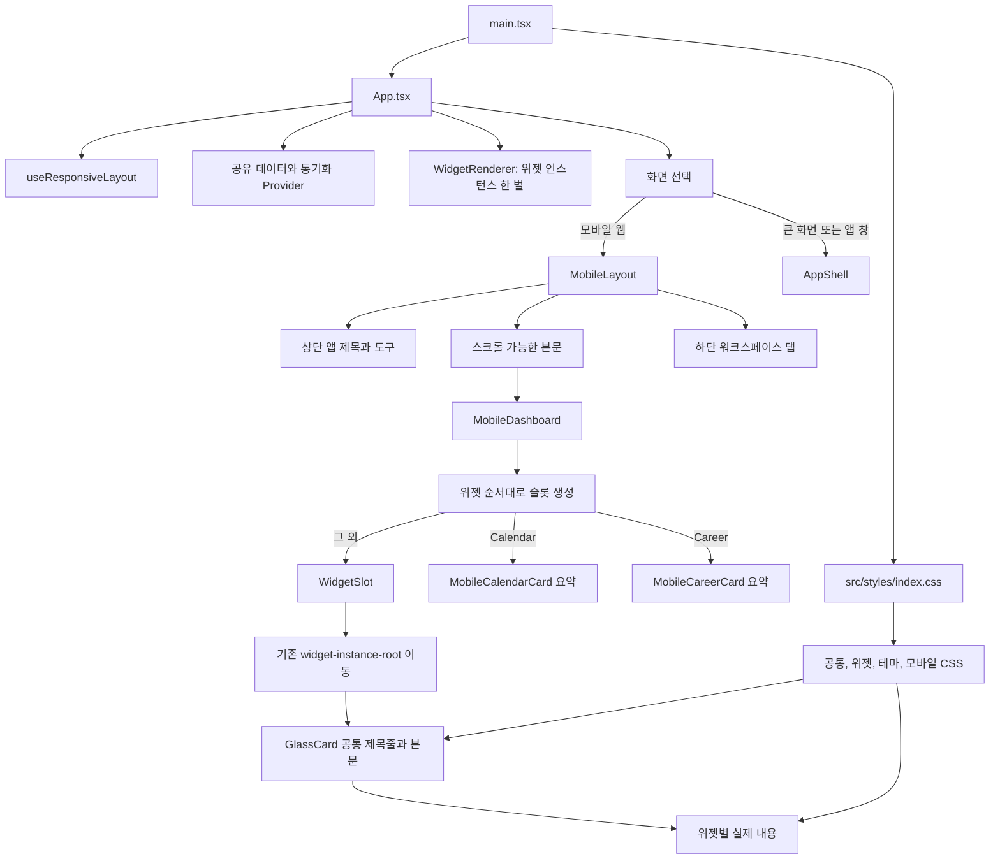
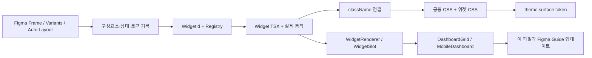

# Glassday 모바일 화면과 코드 지도

이 문서는 코드를 처음 보는 사람도 모바일 화면의 한 부분을 찾아 수정할 수 있도록 화면, React 파일(TSX), 스타일(CSS), 데이터 연결을 한곳에 모은 안내서입니다. Figma 시안을 실제 코드로 옮기거나 새 위젯을 추가할 때 시작점으로 사용합니다.

> **먼저 볼 곳**
> - 모바일 화면 전체 배치: `src/components/layout/MobileLayout.tsx`
> - 위젯 순서와 슬롯: `src/components/mobile/MobileDashboard.tsx`
> - 공통 위젯 제목줄/간격/카드 크기: `src/styles/mobile-common.css`
> - 색, 투명도, blur: `src/styles/theme-surfaces.css`, `src/styles/mobile-glass.css`
> - TSX와 CSS의 전체 관계 및 Figma 준비: [UI Architecture and Figma Guide](UI_ARCHITECTURE_AND_FIGMA_GUIDE.md)

## 1. 화면이 만들어지는 순서



화면이 바뀔 때마다 위젯을 새로 만드는 구조가 아닙니다. `WidgetRenderer`가 위젯 React 인스턴스 한 벌을 유지하고, `WidgetSlot`이 그 화면 요소를 데스크톱 그리드나 모바일 슬롯으로 옮깁니다. 따라서 모바일 요약 화면에 기존 위젯을 한 번 더 렌더링하지 않습니다. 입력 중인 내용과 타이머 같은 상태를 한 벌로 유지하기 위한 구조입니다.

### 모바일 화면 골격

```text
MobileLayout                         화면 전체 높이와 3단 배치
├── mobile-header                    워크스페이스 이름, 검색, 추가, 설정
├── mobile-main                      세로 스크롤 영역
│   └── MobileDashboard              현재 탭에 들어 있는 위젯 순서
│       └── mobile-widget-slot       위젯별 외부 간격/레이아웃 슬롯
│           └── widget-instance-root 기존 위젯 화면을 옮기는 투명 host
│               └── GlassCard        공통 테두리/제목줄/본문 틀
│                   ├── header      아이콘, 제목, 필요 시 동작 버튼
│                   └── body        위젯의 실제 기능 화면
└── MobileNavigation                 하단 탭과 빠른 추가 버튼
```

Calendar와 Career는 모바일에서 자체 요약 카드를 씁니다. Calendar 요약은 `MobileCalendarCard.tsx`, Career 요약은 `MobileCareerCard.tsx`입니다. **Study는 별도 모바일 요약 컴포넌트가 아니라 기존 `StudyWidget` 전체를 `WidgetSlot`으로 표시합니다.** `MobileStudyCard.tsx`나 `mobile-study.css`는 현재 구조에 없습니다.

## 2. TSX는 무엇이고 CSS와 어떻게 연결되나요?

- **TSX**는 화면에 어떤 요소가 있고, 어떤 제목/아이콘/버튼/데이터를 보여주는지 적는 파일입니다. 예: `DailyJournalWidget.tsx`.
- **CSS**는 TSX가 만든 요소의 크기, 위치, 색, 여백, 테두리, blur를 정합니다. CSS 선택자 안의 `.journal-section` 같은 이름은 TSX의 `className="journal-section"`과 연결됩니다.
- 이 앱의 화면 컴포넌트는 CSS 파일을 제각각 불러오지 않습니다. `src/main.tsx`가 `src/styles/index.css`를 불러오고, 그 파일에서 다른 CSS를 순서대로 연결합니다.
- **데이터/동작**은 컴포넌트 또는 Hook/Context가 담당합니다. 버튼의 `onClick`, 입력의 `onChange`를 유지한 채 CSS로 모양을 바꿉니다.

예를 들면 Daily Journal은 다음과 같이 연결됩니다.

```text
DailyJournalWidget.tsx
  ├─ <GlassCard className="daily-journal-widget" title="Daily Journal">
  ├─ className="journal-section" / "journal-task-item" 등으로 내용 이름 지정
  └─ 날짜·할 일 저장과 버튼 동작
       ↓ class 이름이 연결 고리
widgets/journal.css       공통/큰 화면 Journal 내부 구성
mobile-journal.css        모바일 날짜 줄/본문 스크롤/작은 화면 구성
mobile-common.css        모든 위젯에 공통인 외부 카드와 제목줄
테마 CSS                 활성 테마의 색과 재질
```

## 3. 모바일 화면 파일 안내

| 파일 | 쉽게 말해 무엇을 다루나요? | 함께 보는 파일 |
|---|---|---|
| `src/App.tsx` | 앱이 모바일 화면인지 큰 화면인지 선택하고, 데이터 제공자와 위젯을 조립 | `useResponsiveLayout.ts`, `MobileLayout.tsx`, `AppShell.tsx` |
| `src/hooks/useResponsiveLayout.ts` | 모바일 브라우저 판정 | `App.tsx` |
| `src/components/layout/MobileLayout.tsx` | 모바일 화면의 위/가운데/아래 뼈대, 상단 버튼, 스크롤, 하단 탭 배치 | `mobile.css`, `MobileNavigation.tsx` |
| `src/components/layout/MobileNavigation.tsx` | 아이콘 중심 하단 탭과 빠른 추가 버튼. 탭 이름 표시 여부는 Display 환경설정에서 제어 | `WorkspaceTabIcon.tsx`, `mobile.css`, `SettingsModal.tsx`, `uiPreferences.ts` |
| `src/components/mobile/MobileDashboard.tsx` | 활성 탭의 `widgetIds` 순서를 슬롯으로 만들고 Calendar/Career의 모바일 요약 카드를 선택 | `WidgetSlot.tsx`, 두 요약 카드 |
| `src/components/mobile/MobileCalendarCard.tsx` | 모바일 달력 요약/전체 화면 | `mobile-calendar.css`, 기존 Calendar 기능 |
| `src/components/mobile/MobileCareerCard.tsx` | 모바일 지원 현황 요약/목록 | `mobile-career.css`, 기존 Career 기능 |
| `src/components/widgets/WidgetRenderer.tsx` | 위젯 이름을 실제 TSX 컴포넌트와 연결하고 각 위젯 인스턴스 한 벌을 생성 | 모든 `*Widget.tsx`, `widgetHostContext.ts` |
| `src/components/widgets/WidgetSlot.tsx` | 이미 만들어진 위젯 화면을 현재 슬롯 위치로 옮김 | `widgetHostContext.ts`, `MobileDashboard.tsx`, `DashboardGrid.tsx` |
| `src/components/widgets/widgetHostContext.ts` | 위젯 화면을 담아 이동시키는 임시 host 생성, 화면 전환 시 입력 커서 보존 | `WidgetRenderer.tsx`, `WidgetSlot.tsx` |
| `src/components/glass/GlassCard.tsx` | 위젯 공통 바깥 틀: 제목/아이콘/동작/본문의 실제 TSX 구조 | `base.css`, `mobile-common.css` |
| `src/components/layout/WorkspaceTabIcon.tsx` | 각 워크스페이스 탭에서 사용할 표시 아이콘 결정 | `MobileNavigation.tsx`, `WorkspaceTabsNav.tsx` |

## 4. 위젯 TSX ↔ CSS 대응표

`widgets/<이름>.css`는 공통/큰 화면의 위젯 내부를, `mobile-<이름>.css`는 모바일 전용 내부 배치만 담당합니다. 각 위젯의 외부 카드와 제목줄은 `GlassCard.tsx`와 `mobile-common.css`가 공통으로 다룹니다.

| 화면의 위젯 | 화면/동작 TSX | 공통/큰 화면 CSS | 모바일 CSS | 데이터·동작의 주요 위치 |
|---|---|---|---|---|
| 오늘 집중 | `widgets/TodayFocusWidget.tsx` | `widgets/today-focus.css` | `mobile.css`, `mobile-common.css` | 공유 일정/커리어 요약 및 오늘 할 일 |
| 알림 | `widgets/AlertCenterWidget.tsx` | `widgets/alert-center.css` | `mobile.css`, `mobile-common.css` | 알림 행과 새로고침 |
| Calendar | `widgets/CalendarWidget.tsx`, `mobile/MobileCalendarCard.tsx` | `widgets/calendar.css` | `mobile-calendar.css` | `DashboardDataContext`, 달력의 월/주/일정 구성요소 |
| Career | `widgets/CareerWidget.tsx`, `mobile/MobileCareerCard.tsx` | `widgets/career.css` | `mobile-career.css` | `DashboardDataContext`, `widgets/career/` 안의 데이터·편집 구성요소 |
| Study Planner | `widgets/StudyWidget.tsx`, `widgets/study/StudyDetailWindow.tsx` | `widgets/study.css` | `widgets/study.css`의 폭별 구성과 `mobile-common.css`의 바깥 카드 규칙 | `studyUtils.ts`, 학습 기록과 과목 관리 |
| Timer | `widgets/TimerWidget.tsx` | `widgets/timer.css` | `mobile-timer.css` | `widgets/timer/usePomodoroTimer.ts` |
| Memo | `widgets/MemoWidget.tsx` | `widgets/memo.css` | `mobile-memo.css` | 메모 데이터, 편집기, 글꼴/종이 색 |
| Daily Journal | `widgets/DailyJournalWidget.tsx` | `widgets/journal.css` | `mobile-journal.css` | `widgets/journal/journalUtils.ts`, 날짜별 기록 |
| Habit Tracker | `widgets/HabitTrackerWidget.tsx` | `widgets/habit-tracker.css` | `mobile-common.css`와 위젯 CSS의 모바일 규칙 | 습관/색상/완료 기록 |
| Money | `widgets/MoneyWidget.tsx` | `widgets/money.css` | `mobile-money.css` | `widgets/money/moneyUtils.ts`, 거래/예산/위시리스트 |
| Mood | `widgets/MoodWidget.tsx` | `widgets/mood.css` | `mobile-common.css`와 위젯 CSS의 반응형 규칙 | 기분 수치와 날짜별 값 |

위젯이 현재 보이지 않거나 불러오지 않는다고 추정되는 옛 파일을 고치기 전에 `WidgetRenderer.tsx`의 `widgetComponents` 목록에 실제로 연결되어 있는지 확인합니다. Health는 현재 렌더러/레지스트리의 위젯이 아닙니다. 새 Habit Tracker는 `habitTracker` ID를 사용합니다.

## 5. CSS 파일 책임과 읽는 순서

실제 연결 순서는 `src/styles/index.css`에 있습니다. 아래 순서와 앞 문서의 간단한 요약이 다르면 `index.css`가 기준입니다.

```text
1. spacing-tokens.css / fonts.css / base.css
   공통 숫자(간격/크기), 글꼴, 앱과 GlassCard 기본 구조
2. layout / controls / dashboard-grid / overlays
   큰 화면 배치, 버튼, 그리드, 팝업
3. themes/*.css / theme-surfaces.css
   테마 색과 공통 표면 재질 변수
4. widgets/*.css
   각 위젯의 기본 내부 구조
5. responsive.css / overrides.css
   반응형 규칙과 기존 큰 화면 호환 조정
6. mobile.css + mobile-calendar/career/memo/money/timer
   모바일 화면 뼈대와 기능별 모바일 조정
7. mobile-pixel / mobile-journal / mobile-finish
   Pixel 화면, Journal 배치, Mac Core와 설정 화면
8. pixel-desktop-parity / pink-diary / desktop-window
   테마 parity 및 앱 창 보정
9. responsive-widgets / mobile-common / mobile-glass / pixel-widget-headers
   모바일 공통 프레임의 최종 치수, Glass 재질, Pixel 제목바
```

마지막에 읽히는 CSS가 앞 규칙을 덮을 수 있습니다. 그래서 파일 책임은 다음처럼 나눕니다.

| 바꾸려는 부분 | 우선 수정할 파일 | 다른 파일에 복사하지 않을 것 |
|---|---|---|
| 모든 모바일 위젯의 바깥 여백, 카드 사이 거리, 제목/아이콘 위치와 높이 | `mobile-common.css`, 값은 `spacing-tokens.css` | 특정 위젯 CSS 또는 테마 파일에 공통 치수 복제 |
| 위젯 본문 안의 버튼/표/행/입력 배치 | 해당 위젯 `widgets/<name>.css`, 필요 시 `mobile-<name>.css` | 다른 위젯까지 포함하는 일반 클래스 덮어쓰기 |
| 배경색, 투명도, blur, 테두리색, 그림자 | `theme-surfaces.css`, `mobile-glass.css`, 테마 전용 파일 | 테마 CSS에 카드 폭/제목 크기 정의 |
| Pixel Desk의 각진 테두리/파란 제목바 | `mobile-pixel.css`, `pixel-widget-headers.css` | Glass 공통 파일에서 Pixel을 위한 중복 규칙 |
| 모바일 바깥 화면/스크롤/하단 탭 | `mobile.css` | 위젯별 CSS에서 앱 전체 배치 정의 |
| 새 전역 CSS 파일 연결 | `styles/index.css` | TSX 여러 곳에서 같은 CSS를 각각 import |

## 6. Figma 시안을 코드로 옮기는 규칙

Figma의 Frame과 Component를 아래 코드 구조에 대응시킵니다.

| Figma | 코드 | 예시 |
|---|---|---|
| 화면 전체 Frame | 화면 레이아웃 컴포넌트 | Mobile Home → `MobileLayout` + `MobileDashboard` |
| 재사용할 카드 Component | TSX 컴포넌트 | Widget → `HabitTrackerWidget` |
| Component 이름/Variant 이름 | `widgetId`, 컴포넌트 prop, 상태 class | `habitTracker`, `is-complete`, `is-editing` |
| Auto Layout의 방향/간격 | CSS `display:flex/grid`, `gap` | 세로 카드 → CSS grid/flex column |
| 색상/타이포 변수 | CSS custom property(token) | `--gd-surface-bg`, `--gd-widget-title-size` |
| 반응형 Variant | container/viewport query | 넓은 카드/좁은 모바일 카드 |
| Prototype Interaction | TSX 이벤트/상태 | 버튼 `onClick`, 폼 `onChange` |

### Figma에서 새 위젯을 설계할 때 먼저 준비할 것

1. **Frame 계층**: `Widget / [이름]` → `Header` → `Content` → 반복 행/상태를 적습니다.
2. **Variant 목록**: 빈 상태, 데이터가 있는 상태, 편집 상태, 작은 화면 상태를 구분합니다.
3. **Auto Layout 수치**: 간격은 4px 단위를 바탕으로 정하고, 카드 바깥 간격과 카드 안 간격을 분리합니다. 예: 카드 내부 16px, 내부 그룹 12px, 같은 그룹의 작은 간격 8px.
4. **토큰**: theme에 따라 바뀔 색은 특정 hex 값으로 고정하지 말고 semantic surface/accent token으로 연결합니다. 저장된 데이터 색(예: 사용자가 정한 Habit 색)은 테마 표면색과 별도입니다.
5. **터치**: 모바일의 자주 누르는 버튼은 터치 가능한 영역을 충분히 확보하고 hover만으로 나타나는 동작을 만들지 않습니다.
6. **동작 연결**: 각 버튼이 어떤 기존 데이터를 바꾸는지 정하고, 저장 위치를 TSX/Hook/Context에서 확인합니다.

### 새 위젯을 실제 앱에 추가할 때 빠지는 곳이 없도록 확인

1. `src/types/workspace.ts`에서 `WidgetId` 규약을 확인합니다. 현재는 `string` 별칭이므로 ID를 별도 목록에 넣는 곳은 아니지만, 이 타입을 제한된 ID 목록으로 바꿀 때는 새 ID도 추가해야 합니다. 저장된 대시보드 데이터가 ID로 화면을 다시 찾으므로 ID는 나중에도 유지합니다.
2. `src/constants/widgets.ts`의 `widgetRegistry`에 실제 영구 ID와 화면 이름, 설명, 분류를 적습니다. 기본 그리드 크기와 위치는 다음 `gridDefaults.ts`에서 정합니다.
3. `src/components/widgets/[Name]Widget.tsx`에 UI와 동작을 만듭니다. 공통 제목/아이콘이 필요하면 `GlassCard`를 사용합니다.
4. `src/components/widgets/WidgetRenderer.tsx`의 `widgetComponents`에 ID와 TSX를 연결합니다.
5. `src/components/grid/DashboardGrid.tsx`의 widget map과 `src/components/grid/gridDefaults.ts`의 기본 위치/크기를 연결합니다.
6. `src/constants/dashboardTabs.ts`에서 새 위젯이 처음 어느 탭에 들어갈지 결정합니다. `useDashboardTabs.ts`가 기존 저장 데이터에 신규 기본 위젯을 어떻게 합치는지 확인합니다.
7. `src/styles/widgets/[name].css`에서 위젯 내부의 넓은 화면 스타일을 만듭니다. 실제 TSX의 `className`과 CSS 선택자가 같은지 확인합니다.
8. 모바일에서도 쓸 수 있으면 해당 위젯의 `mobile-[name].css` 또는 위젯 CSS의 모바일 구간을 추가하고 `src/styles/index.css`에서 한 번만 import합니다. 모바일 슬롯과 제목 규칙은 `mobile-common.css`에 맡깁니다.
9. [UI Architecture and Figma Guide](UI_ARCHITECTURE_AND_FIGMA_GUIDE.md)와 이 표를 업데이트해 다음 사람이 찾을 수 있게 합니다.



## 7. 주석을 읽거나 새로 쓸 때

코드 주석은 코드 문장을 그대로 반복하지 않고 **무엇을 담당하는지, 연결 파일이 무엇인지, 고치면 어디에 영향이 가는지**를 적습니다. 비개발자도 검색할 수 있도록 실제 화면 이름과 파일 경로를 씁니다.

```tsx
/**
 * [화면 역할] Habit Tracker의 습관 목록과 오늘 완료 표시를 그립니다.
 * [Figma 연결] Widget / Habit Tracker → Header, Weekly Progress, Habit Row.
 * [스타일 연결] className은 widgets/habit-tracker.css의 같은 선택자로 꾸밉니다.
 * [데이터] 완료/색상 저장은 이 컴포넌트의 state와 storage hook이 맡습니다.
 * [수정 영향] 제목줄의 높이나 카드 바깥 여백은 여기서 바꾸지 않고
 * mobile-common.css의 공통 Widget Frame 규칙을 사용합니다.
 */
```

## 8. 자주 찾는 문제

- **제목이나 아이콘의 높이/시작선이 위젯마다 다름** → `mobile-common.css`의 `FINAL MOBILE WIDGET HEADER CONTRACT`.
- **카드 안쪽 여백이 다름** → `mobile-common.css`의 공통 `widget-frame__body` 규칙과 `--mobile-widget-inset` 토큰. 위젯 내부에 padding이 한 번 더 있는지도 확인.
- **한 위젯 내용이 다음 위젯 위로 흘러감** → 슬롯/host/card의 실제 높이, `container-type:size`의 크기 제한, `height:100%`, `min-height:0`, `overflow`를 함께 확인. 눈에 보이는 선이나 투명도를 먼저 바꿔 덮지 않습니다.
- **Timer의 원/버튼이 겹침** → `mobile-timer.css`의 세로 grid와 카드/슬롯 높이 연결을 함께 확인.
- **Daily Journal 날짜줄과 제목/요약의 위치가 다름** → 제목줄은 `mobile-common.css`, 날짜줄/고정 요약/내부 스크롤은 `mobile-journal.css`.
- **테마 하나만 불투명하거나 blur가 다름** → `theme-surfaces.css`의 token 값과 `mobile-glass.css`/테마 규칙에서 개별 색상 덮어쓰기가 있는지 확인.
- **하단 탭 아이콘이 다름** → `WorkspaceTabIcon.tsx`와 `MobileNavigation.tsx`.
- **새 위젯이 추가 목록에만 있고 화면에 안 나옴** → ID, Registry, Renderer map, Grid map, 기본 탭을 순서대로 확인.
